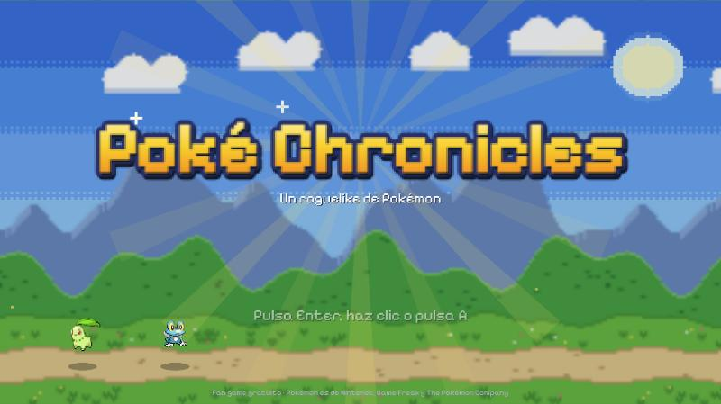
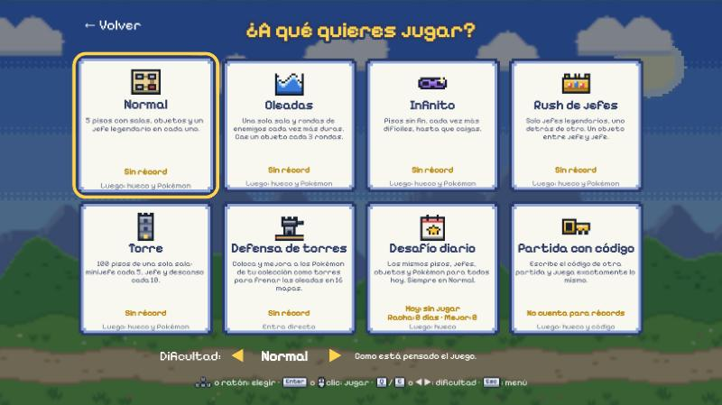
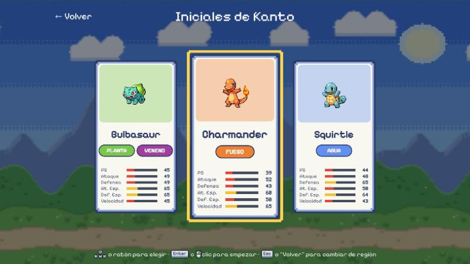
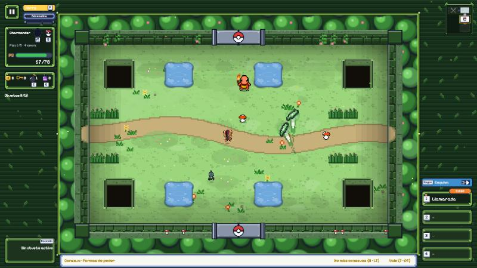
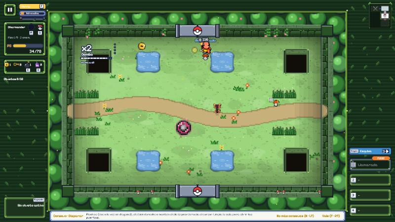
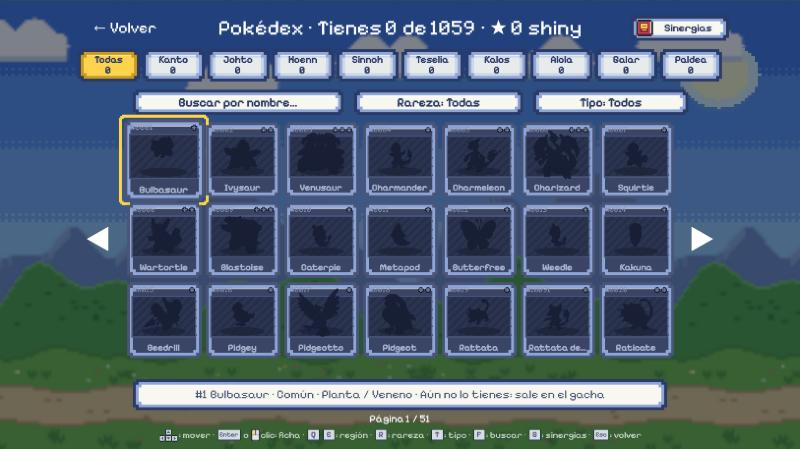
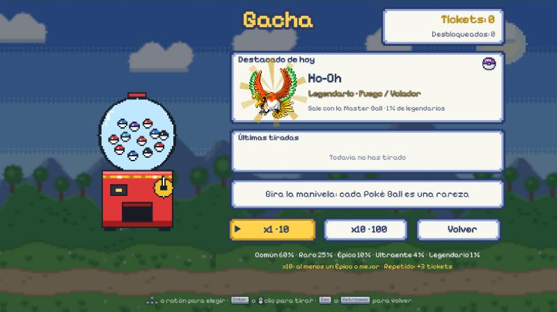
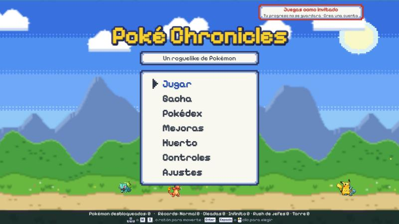
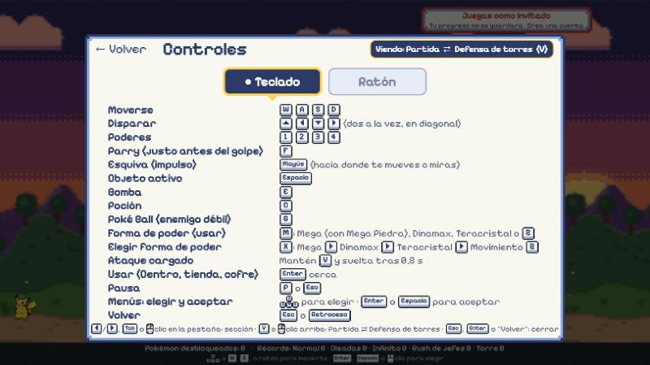

<div align="center">

# Poké Chronicles

**Un roguelike de Pokémon en el navegador, al estilo de *The Binding of Isaac*.**

[](https://roberfdez06.github.io/Poke-Chronicles/)




</div>

Recorres pisos llenos de salas, limpias a los enemigos, coges objetos y poderes, y te enfrentas a jefes legendarios.
Es un **fan game gratuito y sin ánimo de lucro** (nunca se cobra dinero real por nada).

> Hecho con Phaser 3, Vite y TypeScript. Se juega en cualquier navegador moderno, con **teclado, ratón o mando**
> (cada uno por sí solo) y también con controles táctiles en móvil.
> **No hace falta instalar nada:** [juégalo aquí](https://roberfdez06.github.io/Poke-Chronicles/). Como invitado se
> puede jugar al instante; con una cuenta (correo o Google) el progreso se guarda en la nube.

## Capturas

| Modos de juego | Elige tu inicial |
|:---:|:---:|
|  |  |
| **Una sala del bosque** | **Combate con combo** |
|  |  |
| **Pokédex (1059 Pokémon)** | **Gacha con tickets** |
|  |  |
| **Menú principal** | **Controles** |
|  |  |

## Cómo se juega

- **Eliges tu Pokémon** (más de 1000, de las 9 regiones) y un modo de juego.
- **Disparas** con los ataques de tu tipo y llevas hasta **4 poderes** (movimientos reales de tu Pokémon, con su propio
  estilo: chorros, rayos, ondas, lluvia, bumeranes…).
- Cada piso tiene su **bioma** (bosque, cueva, mar, volcán, torre, ciudad, nieve, pantano, cumbre), sus enemigos con
  distintas formas de moverse, un **minijefe** (un pseudolegendario o un ultraente) en su propia sala y un **jefe
  legendario** con dos fases. La **Mega Piedra** la custodia un guardián (otro pseudolegendario o ultraente) en su
  guarida: al vencerlo la suelta.
- **Formas de poder**: Megaevolución (basta con llevar la Mega Piedra; una vez por piso), Dinamax/Gigamax (con la
  Banda Dinamax), Teracristal y Movimiento Z (con el medidor de poder). M / cruceta arriba / clic en el icono junto a
  la Poké Ball usa la forma elegida; X / cruceta izquierda o derecha / clic derecho o rueda sobre el icono la cambia.
- **Pokémon oscuros**: variante rara con aura morada y negra, más fuerte en todo. Salen como enemigos (más cuanto más
  hondo), minijefes, jefes y legendarios; capturando uno (o en el gacha) lo tienes oscuro en la colección y juegas con
  él así.
- Hay **Centro Pokémon**, **tienda**, cofres con llave, bombas, salas sorpresa (Pokémon raro que huye, mercader, altar,
  cofre trampa) y clima distinto en cada piso. Desde el piso 2 algunas salas traen una **regla especial** (un solo
  tipo de daño, enemigos que se multiplican, sala a oscuras o de velocidad), marcada en el minimapa.
- Al terminar el piso 5 puedes aceptar el **reto final**: el trío legendario o un gigante, elegido al azar.
- **«Una más»**: al caer, una vez por partida, puedes volver con media vida pagando caramelos o tickets (tú eliges).
- Los **pasivos** de los objetos se combinan en sinergias: 14 que transforman tu ataque (orbitales, rastros, rayos en cadena, eco, aura, reflejo…) y 3 transformaciones de tres piezas que cambian tu aspecto. Las descubiertas se apuntan en el **Libro de sinergias** (Pausa → Sinergias, o en la Pokédex con el botón, G o L3); los objetos que completarían una se marcan con una insignia y «Sinergia: …».
- **Fusión de poderes** (Pausa → Fusionar poderes): juntas dos de tus poderes en uno más fuerte (≈1,6× de potencia)
  que ocupa una ranura y deja la otra libre. Cada pareja de tipos tiene su receta (Vapor Ardiente, Raíz Sísmica,
  Descarga Marina…; las del mismo tipo dan la versión «Superior») con un proyectil, estela, impacto y sonido únicos.
  Una fusión por piso, para siempre, y lo fusionado no se vuelve a fusionar. La ranura fusionada lleva marco dorado.
- **Parry**: púlsalo justo antes de un golpe (ventana amplia de 0,4 s; una marca «!» sobre el enemigo o el proyectil
  avisa y se pone blanca cuando toca pulsar). Anula el golpe, devuelve el proyectil o aturde a quien te pega, y tu
  siguiente ataque es crítico; en la primera mitad de la ventana es **perfecto** (más premio). Fallar solo tiene un
  enfriamiento corto. Los ataques de zona y los láseres de los jefes no se bloquean: para eso está la **esquiva**
  (impulso corto invulnerable, recarga 1,2 s). Las bajas, esquivas y parrys llenan la **adrenalina**: al llenarse,
  unos segundos con más velocidad y daño.
- **Combo**: cada golpe que daña a un enemigo suma (también quemaduras, áreas, reflejos y el ayudante); tienes 2,5 s
  para el siguiente (no corre en pausa ni en las intros). Niveles **Racha** (x5), **Frenesí** (x15), **Imparable**
  (x30) y **Leyenda** (x60) con más daño, velocidad, botín y medidor. El máximo sale en el resumen y queda como récord.
- El **botín** sale despedido al caer y vuela hacia ti cuando te acercas (más lejos con el Zahorí).

## Modos

| Modo | En qué consiste |
|---|---|
| **Normal** | 5 pisos y reto final. |
| **Oleadas** | Una sola sala, rondas con más enemigos. |
| **Infinito** | Como Normal, pero sin final. |
| **Rush de jefes** | Solo jefes legendarios, uno tras otro. |
| **Torre** | 100 pisos de una sola sala: minijefe cada 5, jefe y descanso cada 10. |
| **Defensa de torres** | Colocas y mejoras los Pokémon de tu colección como torres para frenar oleadas en 16 mapas. Cada nivel cambia el mapa (atajos, entradas nuevas, rocas y terreno), hay enemigos con trucos, sinergias entre torres vecinas, trampas, barricadas y torres que se pueden mover. Cada nivel tiene un **tipo tema** (los 18 tipos repartidos por los mapas): potencia tus torres de ese tipo, cambia el suelo, los obstáculos, el ambiente y el terreno, y trae enemigos y jefe de ese tipo con contra-tipos al final. |
| **Desafío diario** | La misma partida para todos ese día, con racha. |
| **Partida con código** | Escribes el código de otra partida y juegas exactamente la misma. |

Tres dificultades (Fácil, Normal, Difícil), cada una con sus récords.

## Progreso fuera de la partida

- **Gacha:** los **tickets** que ganas jugando se gastan en tiradas para desbloquear nuevos Pokémon (común, raro,
  épico, ultraente y legendario, con shinies).
- **Mejoras:** los **caramelos**, que también se ganan jugando, suben las estadísticas de cada Pokémon (daño, PS,
  velocidad, cadencia, alcance, crítico y defensa).
- **Pokédex**, misiones y logros, historial de partidas y tutorial.
- **Cuentas opcionales** (Firebase): el progreso se guarda en la nube. Como invitado se puede jugar, pero no se guarda.

## Controles

| Acción | Teclado | Ratón | Mando |
|---|---|---|---|
| Moverse | W A S D | Clic derecho hacia el cursor | Stick izquierdo |
| Disparar | Flechas | Clic izquierdo hacia el cursor | Stick derecho |
| Poderes 1-4 | 1, 2, 3, 4 | Clic en la ranura | A, B, X, Y |
| Objeto activo / bomba | Espacio / E | Clic en su cuadro | LB / RB |
| Parry (justo antes del golpe) | F | Clic central (rueda) o clic en su cuadro | RT |
| Esquiva | Mayús | Doble clic derecho o clic en su cuadro | Cruceta abajo |
| Pausa | Esc o P | Botón ❚❚ | Start |

Las teclas se pueden cambiar en **Ajustes > Controles y teclas**. En el juego, **Controles** enseña solo los del
dispositivo que estés usando.

## Publicación (GitHub Pages)

Cada `git push` a `main` ejecuta el workflow [`deploy.yml`](.github/workflows/deploy.yml): instala, pasa las pruebas,
compila y publica en GitHub Pages. La configuración web de Firebase (que es pública por diseño) se guarda como
*variables* del repositorio y el modo administrador **no** se incluye en la web pública. Las reglas de seguridad de los
datos están en [`firestore.rules`](firestore.rules): cada jugador solo puede leer y escribir lo suyo. Más en
[`SECURITY.md`](SECURITY.md).

## Probarlo en tu ordenador

Necesitas Node.js 22.6 o superior.

```bash
npm install
npm run dev      # abre la URL que muestra Vite (normalmente http://localhost:5173)
npm test         # pruebas de la lógica (node --test)
npm run e2e      # pruebas en navegador con Playwright
npm run build    # compila para producción
```

Las **cuentas en la nube** son opcionales: sin configurar nada, el juego funciona como invitado. Para activarlas hay
que crear un proyecto de Firebase y poner sus claves en un `.env.local` (que no se sube a git). Los pasos están en
[`docs/DESARROLLO.md`](docs/DESARROLLO.md).

## Por dentro

- `src/data`: reglas y datos puros (objetos, modos, gacha, ataques, mejoras…), con pruebas en `tests/`.
- `src/level`: generación de pisos, salas y biomas.
- `src/scenes`: las pantallas de Phaser (menús, partida, resumen…).
- `src/ui`: HUD, arte pixel generado por código, sonido y música sintetizados con Web Audio (sin archivos de audio).
- La documentación de diseño y la bitácora de desarrollo están en [`docs/`](docs/).

## Créditos

- Datos de Pokémon: [PokeAPI](https://pokeapi.co/).
- Sprites animados: [PMDCollab SpriteCollab](https://sprites.pmdcollab.org/), licencia CC BY-NC 4.0.
- Fuente: Pixelify Sans (SIL Open Font License).
- *Pokémon* y todos sus nombres y personajes son de Nintendo, Game Freak y The Pokémon Company. Este proyecto no
  está afiliado a ellos.

## Legal

- [Créditos y aviso legal](public/aviso-legal.html) y [Privacidad](public/privacidad.html). En la web publicada: `aviso-legal.html` y `privacidad.html` junto al juego (p. ej. https://roberfdez06.github.io/Poke-Chronicles/aviso-legal.html).
- En el juego: menú principal → «Créditos y legal» (dos apartados, con desplazamiento; teclado, ratón y mando).
- El texto vive en `src/data/legal.ts`; las páginas HTML se generan con `node scripts/genLegal.ts` (un test comprueba que coinciden).
- Contacto, retirada de contenido y derechos de privacidad: [incidencias de GitHub](https://github.com/RoberFdez06/Poke-Chronicles/issues) (sin datos personales: son públicas).

## Licencia

**Todos los derechos reservados** © 2026 Roberto Fernández Mañero. El código es visible para consulta, pero no se
puede copiar, modificar ni redistribuir sin permiso del autor. Ver [`LICENSE`](LICENSE).
